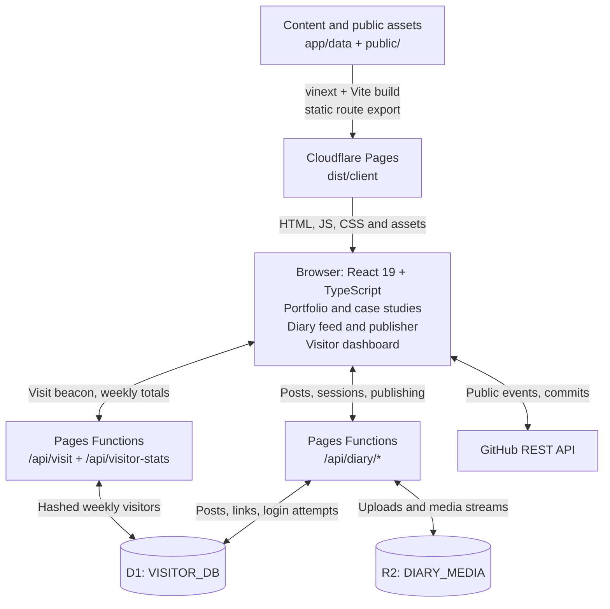
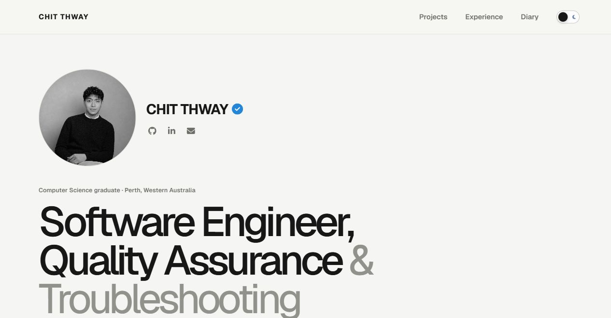
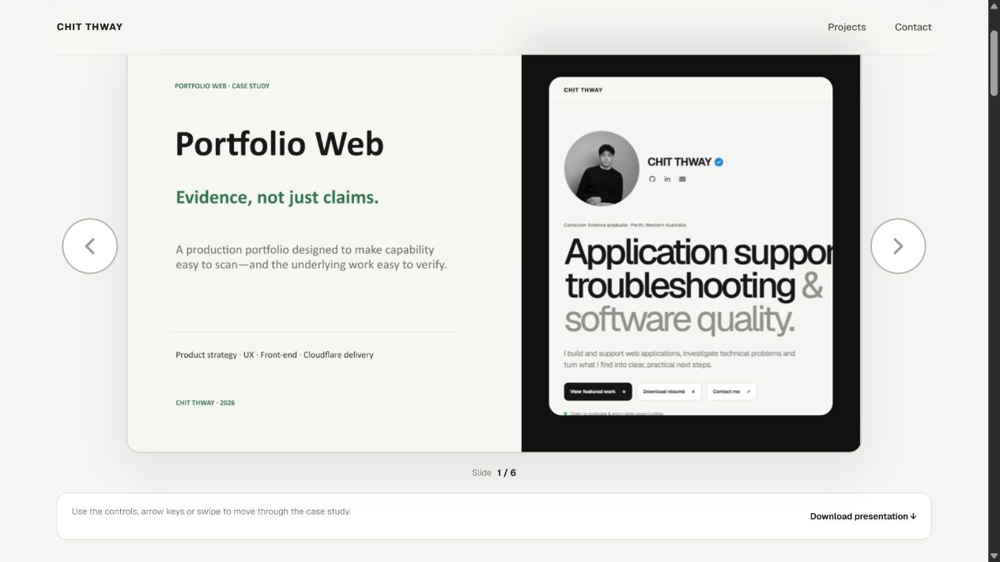

# CHIT THWAY — Portfolio

A production portfolio built to show the work behind the résumé: live projects, practical case studies, technical decisions and support-minded problem solving.

[**View the live portfolio**](https://chitthwayportfolio.com) · [LinkedIn](https://www.linkedin.com/in/chit-thway-197241332) · [GitHub profile](https://github.com/Chit-Thway)

## Architecture

The production site combines exported portfolio pages with browser-driven features and Cloudflare Pages Functions. Profile and project content comes from local TypeScript definitions; Diary posts and visitor totals come from APIs.



1. **Build and delivery:** [portfolio content](app/data/portfolio.ts) and the [project registry](app/data/projects/index.ts) feed the React pages. `npm run build:pages` builds with vinext/Vite, then [exports each route](scripts/export-pages.mjs) as HTML into `dist/client`. Pages serves that HTML and the client assets; React hydrates the interactive components.
2. **Diary reads and publishing:** `DiaryFeed`, `DiaryLoginForm` and `DiaryManager` call `/api/diary/*`. Functions validate publishing requests with signed sessions and same-origin checks, store post/media metadata and links in D1, and store uploaded files in R2. Public media endpoints check for a published D1 record before streaming from the private bucket, including byte-range support for video and audio.
3. **Visitor counting:** `VisitorBeacon` posts to `/api/visit`, which stores a hashed visitor identifier once per Perth calendar week in D1. `VisitorDashboard` reads current and previous weekly totals through `/api/visitor-stats`.
4. **Project media and activity:** PDFs and slide images are public assets. Three project demo MP4s pass through [a Pages Function](functions/projects/[[path]].js) for range requests against Pages assets. `GitHubActivity` fetches public events directly from GitHub in the browser, with an authored-commit fallback.

Production routing and storage bindings are defined in [public/_routes.json](public/_routes.json) and [wrangler.toml](wrangler.toml). The [Worker entry point](worker/index.ts) supports vinext development and build-time rendering; the Pages deployment uses exported HTML and the separate `functions/` handlers.

## Technology stack

| Area | Technology | Purpose |
| --- | --- | --- |
| Frontend | React 19.2, TypeScript 5.9 | Portfolio pages and interactive browser components |
| Framework and build | vinext 1.0 beta, Vite 8 | App Router-compatible pages, production build and static route export |
| Styling | CSS Modules, global CSS, Tailwind CSS 4 via PostCSS | Responsive layouts, light/dark themes and reduced-motion rules |
| Hosting | Cloudflare Pages | Exported HTML and assets from `dist/client` |
| Backend | Cloudflare Pages Functions, JavaScript | Diary/authentication APIs, visitor APIs and project video range responses |
| Database | Cloudflare D1 (SQLite) | `VISITOR_DB`: Diary posts, media metadata, links, login attempts and weekly visitors |
| Schema tooling | Drizzle ORM / Drizzle Kit | TypeScript schema and SQL migration generation; API handlers use D1 prepared statements directly |
| Media | Cloudflare R2 | `DIARY_MEDIA`: private bucket accessed through Diary Functions |
| External data | GitHub REST API | Recent public activity fetched directly by the browser |
| Security | HMAC-signed HttpOnly sessions, SameSite cookies, same-origin checks, D1 login throttling | Protection for Diary publishing and management |
| Quality | ESLint, Node test runner | Rendered HTML, visitor, auth, Diary and project video checks |

## Main features

| Main interface | Case-study slide viewer |
| --- | --- |
| [](https://chitthwayportfolio.com/) | [](https://chitthwayportfolio.com/projects/portfolio-v2/) |

Compact landscape captures of the live site: the homepage and the interactive case-study viewer. Click either preview to open the corresponding page.

- Employer-focused project summaries and deeper case studies showing delivery, troubleshooting, QA and technical decisions
- Project videos, keyboard/swipe-controlled slide decks, PDF viewers, repositories and downloadable presentations
- Public Diary with multi-image, video, optional audio and link attachments, plus protected creation, editing and deletion
- Weekly visitor totals and a live public GitHub activity panel
- Responsive light/dark interfaces, keyboard navigation, visible focus states and reduced-motion support

## Run locally

Requirements: Node.js `>=22.13.0` and npm.

```bash
npm install
npm run dev
```

For the complete local Pages and Diary preview, configure `.dev.vars` from `.dev.vars.example`, then run:

```bash
npm run dev:pages
```

This builds the exported site and runs a local Node server at `http://localhost:4173`, using SQLite and filesystem adapters for the D1/R2 bindings. Local data is kept under `.wrangler/local-diary-preview/`.

Production checks:

```bash
npm run check
```

## Project map

```text
app/                  Portfolio pages, components and content
app/data/projects/    One definition per portfolio project and the project registry
functions/api/        Cloudflare Pages API endpoints
server/               Authentication, Diary and media helpers
db/schema.ts          Drizzle definitions for D1 tables
migrations/           D1 database migrations
scripts/              Static route export and local Pages preview
public/               Images, videos, documents and presentations
docs/images/          Compact README interface screenshots
tests/                Rendered-page, API, auth and storage checks
```

Profile and experience content is maintained in `app/data/portfolio.ts`. Each project's homepage and case-study content lives together in `app/data/projects/` and is exposed through the central project registry.

## Documentation

- [Portfolio release history](docs/portfolio-release-history.md)
- [Diary setup and operations](docs/diary-operations.md)

## Deployment

The production site is deployed through Cloudflare Pages at [chitthwayportfolio.com](https://chitthwayportfolio.com).

```bash
npm run build:pages
npx wrangler pages deploy dist/client --project-name chitthway-portfolio --branch main
```

Designed, built, tested and deployed by **Chit Thway** in Perth, Western Australia.
